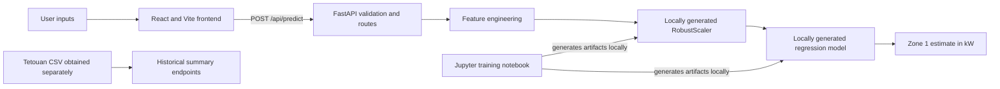

# VoltCast

VoltCast is a full-stack power-consumption estimation project. It combines a Jupyter model-training workflow, a FastAPI inference service, and a React interface for submitting weather and time inputs.

**Live previews:** [Estatora](https://estatora.onrender.com/) · [VoltCast](https://voltcast.onrender.com/) · [Tranzacta](https://tranzacta.onrender.com/)

VoltCast predicts **Zone 1 power consumption** for a supplied timestamp and weather observation. It is a single-point regression tool: it does not fetch live weather, read grid telemetry, or generate an autonomous multi-step forecast.

## Contents

- [Project overview](#project-overview)
- [Problem and objectives](#problem-and-objectives)
- [Features](#features)
- [Prediction workflow](#prediction-workflow)
- [Dataset and preprocessing](#dataset-and-preprocessing)
- [Feature engineering](#feature-engineering)
- [Model training and evaluation](#model-training-and-evaluation)
- [Technology and architecture](#technology-and-architecture)
- [Repository structure](#repository-structure)
- [Prerequisites](#prerequisites)
- [Setup and running locally](#setup-and-running-locally)
- [Configuration](#configuration)
- [API usage](#api-usage)
- [Tests and build](#tests-and-build)
- [Implementation notes and limitations](#implementation-notes-and-limitations)
- [Security and data licensing](#security-and-data-licensing)
- [License](#license)

## Project overview

VoltCast packages a notebook-developed regression workflow as an application:

1. The notebook cleans and explores historical Tetouan City power-consumption data, engineers temporal and weather-derived features, compares regressors, and saves the selected model and scaler locally.
2. The FastAPI backend loads that artifact and uses the same feature order and fitted scaler to serve validated prediction requests.
3. The React frontend collects the timestamp and weather values, calls the API, and displays the returned estimate.

This is a source-only release: neither the dataset nor the trained model artifact is included. The API can start without them, but reports degraded prediction readiness (`503` for predictions) until a compatible local model is trained. Historical summary endpoints also report data as unavailable until a local CSV is supplied.

## Problem and objectives

Electricity demand varies with weather and time patterns. VoltCast explores whether those inputs can estimate Zone 1 demand using the historical dataset, then makes the selected model accessible through a small web application.

The implementation aims to preserve the notebook's preprocessing and model-serving workflow, expose predictions through a typed API, and provide a simple browser-based input form. Previously recorded holdout results are documented as notebook results, not as a guarantee of performance on new regions, future periods, or operational data.

## Features

- React form for timestamp, temperature, humidity, wind speed, and diffuse-flow inputs.
- FastAPI request validation and JSON prediction responses.
- Notebook workflow for feature engineering, model comparison, and local artifact generation.
- Time-based feature engineering shared between notebook training and API inference.
- Health readiness, model metadata, evaluation metrics, and dataset summary endpoints.
- CORS origins, model path, dataset path, and application metadata configurable through environment variables.

## Prediction workflow

1. A user enters a timestamp and weather observations in the frontend.
2. The frontend sends those values to `POST /api/predict`.
3. Pydantic validates the timestamp and numeric ranges; extra fields and non-finite numeric values are rejected.
4. The backend derives calendar, cyclical, and interaction features, orders them using the artifact's saved feature list, and applies the saved scaler to its fitted continuous columns.
5. The saved regression model returns a Zone 1 power estimate in **kW**.
6. The API returns the estimate, unit, model name, timestamp, and feature/dataset metadata.

The time and weather values are supplied by the caller. VoltCast does not calculate weather forecasts or retrieve measurements from an external service.

## Dataset and preprocessing

The project's original dataset is the **Tetouan City Power Consumption** dataset from the [UCI Machine Learning Repository](https://archive.ics.uci.edu/dataset/849/power+consumption+of+tetouan+city). A matching file is also listed on Kaggle as [Electric Power Consumption](https://www.kaggle.com/datasets/fedesoriano/electric-power-consumption); the Kaggle page is a mirror reference, not the documented project provenance.

The CSV contains 52,416 ten-minute observations from 2017 and nine columns:

- Timestamp (`Datetime`)
- Weather: `Temperature`, `Humidity`, `WindSpeed`, `GeneralDiffuseFlows`, and `DiffuseFlows`
- Demand: `PowerConsumption_Zone1`, `PowerConsumption_Zone2`, and `PowerConsumption_Zone3`

The model target is `PowerConsumption_Zone1`; the other zones are excluded from model inputs. Power values are in **kW**, not kWh. The dataset is not included in this repository. Obtain it from a source whose terms permit your intended use and place it at `backend/data/powerconsumption.csv`.

The notebook:

1. Normalizes column names and parses `Datetime`.
2. Coerces feature and target values to numeric form, replaces infinities, and drops invalid rows and duplicates.
3. Sorts observations chronologically.
4. Engineers features, then splits the ordered rows into the first 80% for training and final 20% for testing without shuffling.
5. Fits `RobustScaler` on continuous training features only, then applies that fitted scaler to both partitions.

The checked-in notebook retains its aggregate evaluation results and plots but not raw dataset previews.

The UCI dataset page specifies [CC BY 4.0](https://creativecommons.org/licenses/by/4.0/); retain its attribution and follow that license when copying or adapting the data. The Kaggle listing labels its data as “Data files © Original Authors,” so do not treat it as a separate clear license grant.

## Feature engineering

The notebook and inference service use the same 17 model inputs:

| Feature group | Features |
|---|---|
| Weather observations | `temperature`, `humidity`, `windspeed`, `generaldiffuseflows`, `diffuseflows` |
| Calendar values | `month`, `day_of_week`, `hour`, `is_weekend` |
| Cyclical calendar encodings | `hour_sin`, `hour_cos`, `day_sin`, `day_cos`, `month_sin`, `month_cos` |
| Derived weather interactions | `total_solar_flow`, `temperature_humidity` |

The cyclical encodings represent hour, weekday, and month as sine/cosine pairs. `total_solar_flow` is the sum of the two diffuse-flow inputs; `temperature_humidity` is their product. The scaler is serialized alongside the model so API inputs receive the training-time transformation.

## Model training and evaluation

The training and comparison workflow is in [`backend/notebooks/power-consumption.ipynb`](backend/notebooks/power-consumption.ipynb). With `RANDOM_STATE = 42`, it compares Linear Regression, Decision Tree, Random Forest (100 estimators), and RBF-kernel Support Vector Regression. The model with the lowest RMSE on the chronological holdout is saved as `backend/app/models/best_model.joblib`; the recorded notebook selected Linear Regression.

The following are the notebook's recorded results on the final 20% holdout. They are historical experiment outputs, not a fresh evaluation run during this release preparation.

| Model | MAE (kW) | MSE (kW²) | RMSE (kW) | R² |
|---|---:|---:|---:|---:|
| Linear Regression | 2,421.06 | 9,633,302.67 | 3,103.76 | 0.7467 |
| Random Forest | 4,132.31 | 21,836,940.00 | 4,673.00 | 0.4257 |
| Decision Tree | 4,355.25 | 26,553,210.00 | 5,152.98 | 0.3017 |
| SVR | 5,031.62 | 34,213,270.00 | 5,849.21 | 0.1002 |

The model artifact and CSV are intentionally excluded. Training locally regenerates the serving model; the API does not provide predictions until that artifact is available.

## Technology and architecture

- **Frontend:** React 18, Vite 6, Tailwind CSS 4, and Lucide React.
- **API:** Python, FastAPI, Pydantic 2, and Uvicorn.
- **Data and machine learning:** pandas, NumPy, scikit-learn, and Joblib.
- **Exploration:** JupyterLab, IPython, Matplotlib, and Seaborn.
- **Testing:** pytest and HTTPX.



The backend separates API routes, request/response schemas, application configuration, and the ML service. The frontend's API helper resolves `VITE_API_BASE_URL`; in Vite development mode it defaults to `http://localhost:8000`.

## Repository structure

```text
VoltCast/
├── backend/
│   ├── app/
│   │   ├── api/                 # FastAPI route definitions
│   │   ├── schemas/             # Prediction request and response models
│   │   ├── services/            # Dataset summary and inference logic
│   │   ├── config.py
│   │   └── main.py
│   ├── notebooks/               # EDA, feature engineering, training, evaluation
│   ├── tests/                   # API and service tests
│   ├── .env.example
│   └── requirements.txt
├── frontend/
│   ├── public/
│   ├── src/
│   ├── .env.example
│   ├── package.json
│   └── package-lock.json
├── .gitignore
├── LICENSE
└── README.md
```

`backend/data/` and `backend/app/models/` are local data/artifact locations and are not tracked in this source-only release.

## Prerequisites

- Python 3.11 or newer.
- Node.js 18 or newer and npm.
- Git.

## Setup and running locally

Clone the repository:

```bash
git clone https://github.com/srabonti-codes/voltcast-energy-forecasting.git
cd voltcast-energy-forecasting
```

### Backend

Create and activate a virtual environment, then install the backend and notebook dependencies:

```powershell
cd backend
py -m venv .venv
.\.venv\Scripts\Activate.ps1
python -m pip install -r requirements.txt
Copy-Item .env.example .env
```

Obtain the dataset from UCI or a source with appropriate terms, save the CSV as `backend/data/powerconsumption.csv`, then run the notebook from `backend/`:

```powershell
New-Item -ItemType Directory -Force data
python -m jupyter lab notebooks/power-consumption.ipynb
```

The notebook writes `app/models/best_model.joblib` relative to the backend directory. Once a compatible model is generated, start the API from `backend/`:

```powershell
python -m uvicorn app.main:app --reload --host 127.0.0.1 --port 8000
```

Without a model artifact, the API can still start, but reports degraded readiness and rejects predictions with `503`. Without the CSV, historical summary endpoints report unavailable.

### Frontend

In another terminal, from the repository root:

```powershell
cd frontend
npm ci
Copy-Item .env.example .env
npm run dev
```

Open the Vite URL printed in the terminal (configured port `5173`). The backend runs at `http://localhost:8000`.

## Configuration

The templates contain no credentials. Keep local `.env` files out of Git and do not put server secrets in Vite variables.

### Backend: `backend/.env`

| Variable | Purpose | Default |
|---|---|---|
| `APP_ENV` | Environment label returned by the root endpoint | `development` |
| `APP_NAME` | API application title | `VoltCast` |
| `APP_VERSION` | API version string | `1.0.0` |
| `ALLOWED_ORIGINS` | Comma-separated CORS origin allowlist | `http://localhost:5173,http://localhost:3000` |
| `MODEL_PATH` | Saved model package path, relative to the backend working directory unless absolute | `app/models/best_model.joblib` |
| `DATA_PATH` | Dataset CSV path, relative to the backend working directory unless absolute | `data/powerconsumption.csv` |

### Frontend: `frontend/.env`

| Variable | Purpose | Default |
|---|---|---|
| `VITE_API_BASE_URL` | FastAPI origin used by the browser | `http://localhost:8000` during development |

Vite exposes `VITE_*` values to browser code, so these variables must contain public configuration only. For a deployed frontend, configure the API URL and the backend's `ALLOWED_ORIGINS` to the corresponding public origins.

## API usage

Interactive OpenAPI documentation is available at `http://localhost:8000/api/docs`.

| Method | Path | Purpose |
|---|---|---|
| `GET` | `/` | Application name, version, environment, and docs path |
| `GET` | `/health` | Basic service health |
| `GET` / `HEAD` | `/api/health` | Model readiness and prediction readiness |
| `GET` | `/api/model-info` | Model name, features, recorded metrics, and dataset summary |
| `GET` | `/api/metrics` | Recorded metrics and dataset summary |
| `POST` | `/api/predict` | Predict Zone 1 consumption |

Example request:

```bash
curl -X POST http://localhost:8000/api/predict \
  -H "Content-Type: application/json" \
  -d '{
    "timestamp": "2024-01-15T18:30:00",
    "temperature": 20,
    "humidity": 60,
    "windspeed": 3.5,
    "general_diffuse_flows": 120,
    "diffuse_flows": 80
  }'
```

The response contains `predicted_consumption`, `unit` (`kW`), `status`, `model_name`, the input timestamp, and feature/dataset metadata. Out-of-range or incomplete inputs receive a validation error.

## Tests and build

Run backend API tests from `backend/`:

```bash
python -m pytest
```

Build the frontend from its directory:

```bash
npm ci
npm run build
```

The build output is generated under `frontend/dist/` and is not source-controlled.

## Implementation notes and limitations

- The API accepts a single timestamp and weather observation, and predicts Zone 1 only. It does not retrieve future weather or predict a sequence of future intervals.
- The frontend requires the user to supply weather inputs. Input bounds do not guarantee that every permitted value is represented in the training data.
- Evaluation uses a chronological 80/20 split from the same 2017 dataset. There is no cross-validation, external dataset validation, uncertainty interval, or live-data evaluation in the current repository.
- A linear model can extrapolate outside the training distribution; the API does not clamp its result or provide an out-of-distribution warning.
- The saved model was serialized with scikit-learn 1.9.1. `backend/requirements.txt` pins that version because loading scikit-learn pickle-based artifacts across versions is not guaranteed.
- Historical summary endpoints depend on the local CSV. If it is unavailable or invalid, those analytics report unavailable; a valid model artifact can still be ready for predictions.
- An earlier public commit contained the CSV and model. This cleanup removes them from the current tree but preserves Git history, so the old blobs remain accessible in that commit. Removing those historical copies would require a coordinated history rewrite; this release does not rewrite history.

## Security and data licensing

- No application credentials are required by the default configuration. Do not commit populated `.env` files or private data.
- Joblib model files use Python pickle serialization. Only load a model artifact from a source you trust; a malicious serialized artifact can execute code.
- The documented original source is the [UCI Tetouan City Power Consumption dataset](https://archive.ics.uci.edu/dataset/849/power+consumption+of+tetouan+city), distributed under [CC BY 4.0](https://creativecommons.org/licenses/by/4.0/). Retain attribution and follow that license when copying or adapting the data.
- The [Kaggle page](https://www.kaggle.com/datasets/fedesoriano/electric-power-consumption) is a matching mirror reference and labels data as “Data files © Original Authors”; check source terms rather than assuming a separate license grant.
- This repository excludes the dataset and trained model. Review the data license before redistributing derivative artifacts.
- The root MIT license applies to original project code, not third-party data or dependencies.

## License

Original project code is provided under the [MIT License](./LICENSE). Dataset terms remain separate and must be checked at the source.
